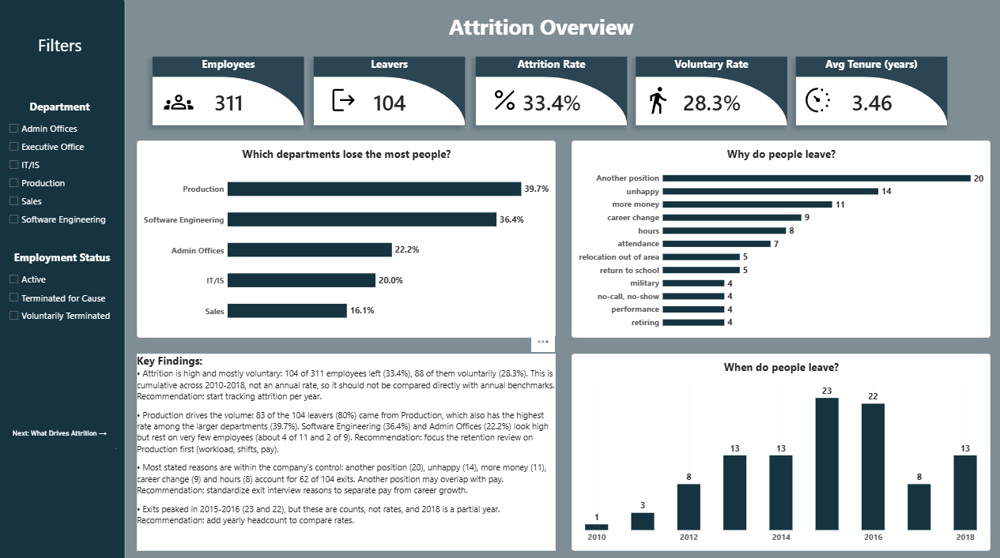
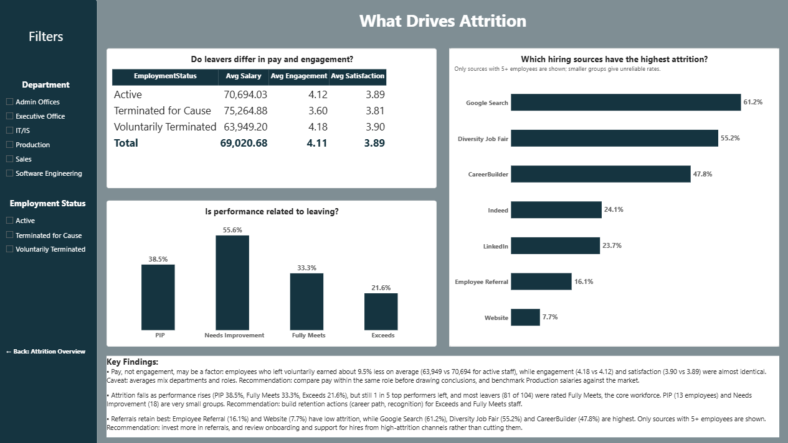

# HR Employee Attrition: What Drives It? (Power BI)

A two-page Power BI dashboard that analyzes employee attrition in the Kaggle "Human Resources Data Set". It shows how large attrition is, where it concentrates, why employees leave, and which factors (pay, performance, hiring source) are associated with leaving, and ends each page with findings and recommendations an HR Business Partner could act on.

## Business question

Where is employee attrition concentrated, why do employees leave, and what can HR do to reduce it?

Questions answered by the dashboard:

1. How large is attrition, and how much of it is voluntary?
2. Which departments lose the most people?
3. Why do people leave, and when?
4. Do leavers differ in pay, engagement and satisfaction?
5. Is performance related to leaving?
6. Which hiring sources have the highest attrition?

## Data

- **Source:** [Human Resources Data Set on Kaggle](https://www.kaggle.com/datasets/rhuebner/human-resources-data-set) (published by rhuebner).
- **Size:** 311 employees, 36 columns. Terminations span 2010-2018.
- **License on Kaggle:** "Data files © Original Authors". The data file is **not included** in this repository. See [`data/README.md`](data/README.md) for how to download it.
- **Cleaning (Power Query):**
  - Profiled all columns on the entire data set. The only meaningful empty column is `DateofTermination` (207 empty values), which matches the 207 active employees (`Termd = 0`), so the empty values are expected.
  - Reconciled status columns: 88 voluntary + 16 for-cause = 104 leavers = employees with `Termd = 1`.
  - Removed personally identifying columns (name, date of birth, zip code, state, manager name) and protected attributes (sex, race, ethnicity, citizenship, marital status), following the data minimization principle: the analysis is at group level.
  - Removed ID columns that duplicate text columns (`DeptID`, `PositionID`, `EmpStatusID`).
  - Trimmed extra spaces in text columns.
  - Added `Perf Order` (custom column) to sort performance scores logically (PIP, Needs Improvement, Fully Meets, Exceeds).

## Tools and techniques

Power BI Desktop, Power Query (M), DAX (`CALCULATE`, `DIVIDE`, `DATEDIFF`, `ISBLANK`), calculated columns vs measures, filter context, visual-level filters, page navigation. All measures are in [`measures.dax`](measures.dax).

## Key measures

| Measure                                  | Idea                                                           |
| ---------------------------------------- | -------------------------------------------------------------- |
| `Employees`                              | Count of rows (one row per employee)                           |
| `Leavers`                                | Employees with `Termd = 1`, using `CALCULATE`                  |
| `Attrition Rate`                         | Leavers divided by employees, using `DIVIDE`                   |
| `Voluntary Rate`                         | Voluntarily terminated divided by employees                    |
| `Tenure Years` (calculated column)       | Years between hire and termination, blank for active employees |
| `Avg Tenure of Leavers`                  | Average of `Tenure Years` (leavers only)                       |
| `Avg Salary / Engagement / Satisfaction` | Averages by employment status                                  |

## Dashboard pages

1. **Attrition Overview:** headline numbers, attrition by department, reasons for leaving, exits by year.
2. **What Drives Attrition:** pay and engagement by employment status, attrition by performance score, attrition by hiring source.

## Key findings

**Overview**

- Attrition is high and mostly voluntary: 104 of 311 employees left (33.4%), 88 of them voluntarily (28.3%). This is cumulative across 2010-2018, not an annual rate.
- Production drives the volume: 83 of the 104 leavers (80%) came from Production, which also has the highest rate among the larger departments (39.7%). Software Engineering (36.4%, 4 of 11) and Admin Offices (22.2%, 2 of 9) look high but rest on very few employees.
- Most stated reasons are within the company's control: "another position" (20), "unhappy" (14), "more money" (11), "career change" (9) and "hours" (8) account for 62 of 104 exits.
- Exits peaked in 2015-2016 (23 and 22), but these are counts, not rates, and 2018 is a partial year.

**What drives attrition**

- Pay, not engagement, may be a factor: employees who left voluntarily earned about 9.5% less on average (63,949 vs 70,694 for active staff), while engagement (4.18 vs 4.12) and satisfaction (3.90 vs 3.89) were almost identical.
- Attrition falls as performance rises (PIP 38.5%, Fully Meets 33.3%, Exceeds 21.6%), but 1 in 5 top performers still left, and most leavers (81 of 104) were rated Fully Meets.
- Employee Referral (16.1%) and Website (7.7%) have the lowest attrition; Google Search (61.2%), Diversity Job Fair (55.2%) and CareerBuilder (47.8%) the highest.

## Limitations

- Rates are cumulative over several years, not annual, so they should not be compared directly with annual benchmarks.
- The data is a fictional snapshot of 311 employees. Small groups (Software Engineering 11, Admin Offices 9, PIP 13, Needs Improvement 18) give unstable rates.
- Hiring sources with fewer than 5 employees are hidden because their rates are unreliable.
- Average salary mixes departments and roles, so pay differences are associations, not causes.
- Findings show association, not causation.

## Recommendations

1. Focus the retention review on **Production** first (workload, shifts, pay), and benchmark Production salaries against the market.
2. Standardize **exit-interview reasons** to separate pay from career growth, and track attrition **per year** with yearly headcount.
3. Invest more in **employee referrals**, and review onboarding and support for hires from high-attrition channels instead of cutting them.
4. Build **retention actions** (career path, recognition) for Exceeds and Fully Meets employees.

## How to view

- Open `dashboard.pdf` or the screenshots in `screenshots/`.
- To rebuild the dashboard: download the CSV from Kaggle (see `data/README.md`), load it in Power BI Desktop, apply the cleaning steps above, add the measures from `measures.dax`.
- The `.pbix` file is not published because it embeds a full copy of the dataset, whose license does not grant redistribution.

## Author

**Fadwa Barnawi** · [LinkedIn](https://www.linkedin.com/in/YOUR-PROFILE) · [GitHub](https://github.com/YOUR-USERNAME) · [Portfolio](https://YOUR-SITE)
